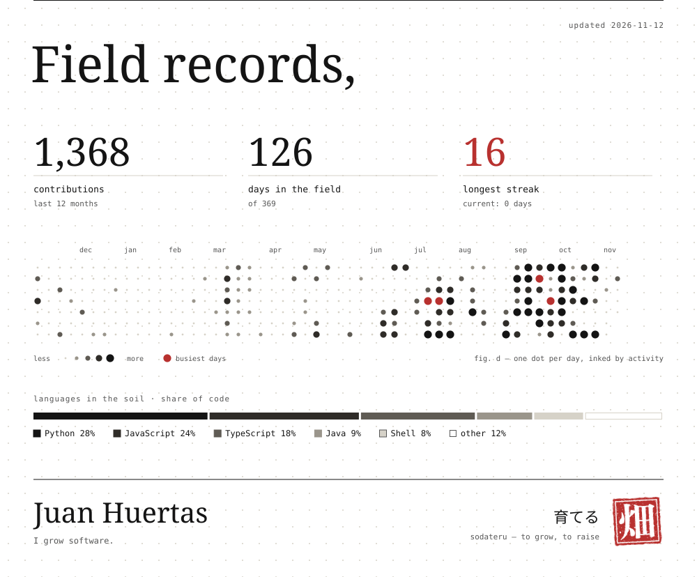

<picture>
  <source media="(prefers-color-scheme: dark)" srcset="./assets/profile-dark.svg">
  
</picture><picture>
  <source media="(prefers-color-scheme: dark)" srcset="./assets/records-dark.svg">
  
</picture>

  
  
  
  

